# Solitaire

A FireMonkey (Delphi 13 / RAD Studio 37.0) solitaire collection for Windows, Android and iOS.

- **Games:** Klondike (draw 1 / draw 3), Spider (1, 2 or 4 suits), FreeCell, Pyramid, TriPeaks
- Rules guide for every game, hints, undo, auto-complete
- Statistics kept per game and variant
- Win effects: bouncing cards, fireworks, fountain, or random
- Two card styles: Classic (corner indexes, traditional pips and pictured court cards; the default) and Modern (large rank and suit)
- Optional sounds (cards being dealt when a game starts, chimes on a win); off by default
- Portrait and landscape layouts; unfinished deals are saved per game

## Screenshots

| Klondike | Spider |
| --- | --- |
| 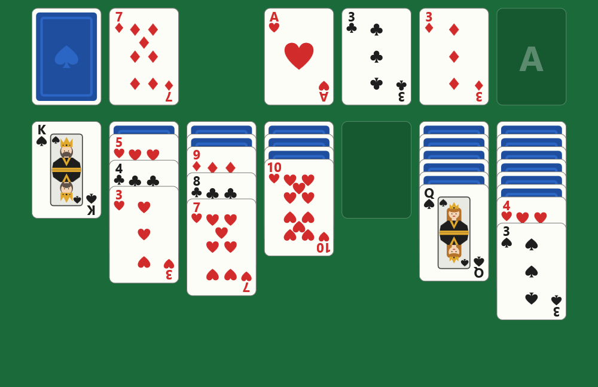 | 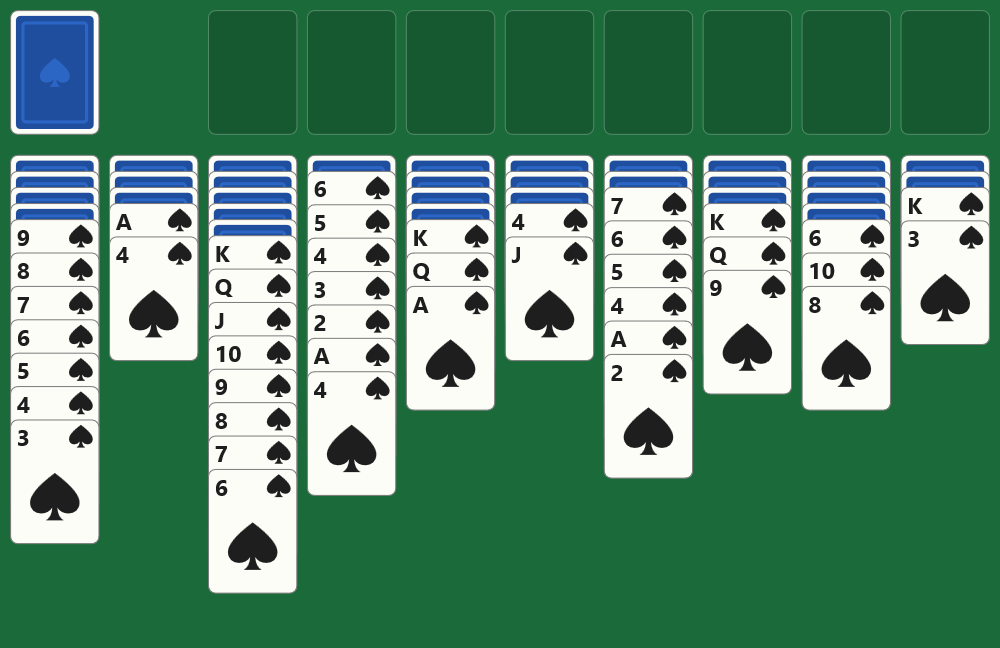 |

| FreeCell | Pyramid |
| --- | --- |
| 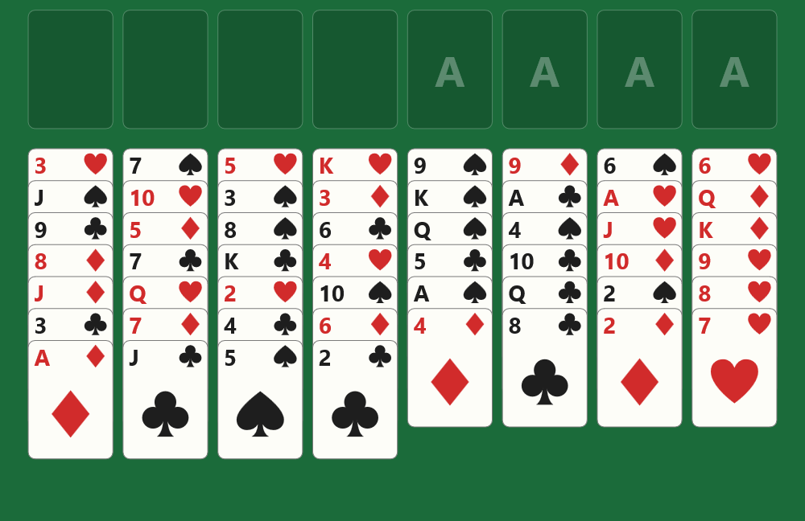 | 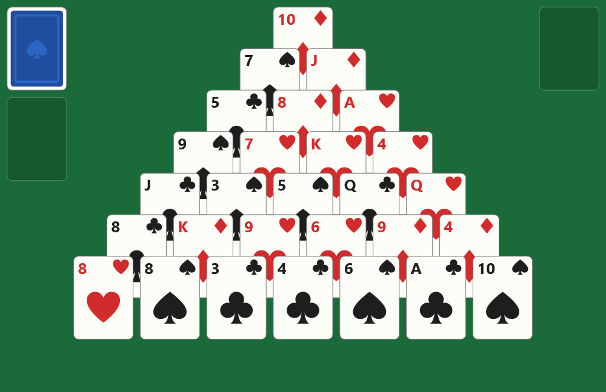 |

| TriPeaks | Winning: bouncing cards |
| --- | --- |
| 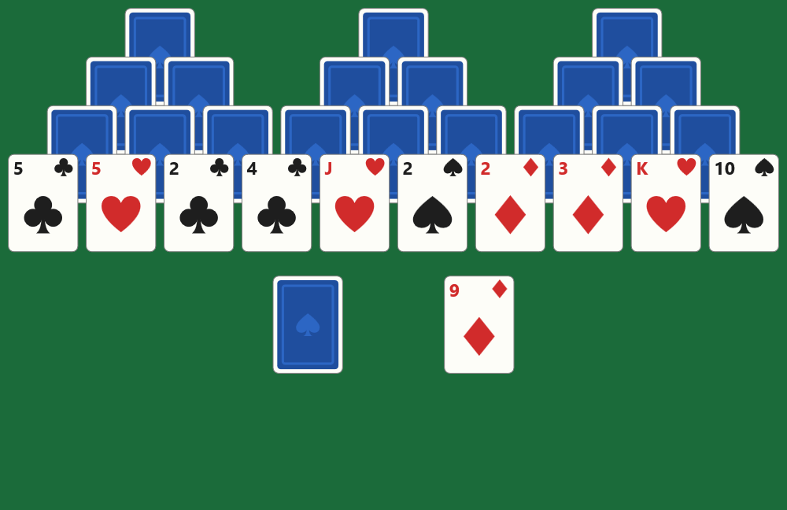 | 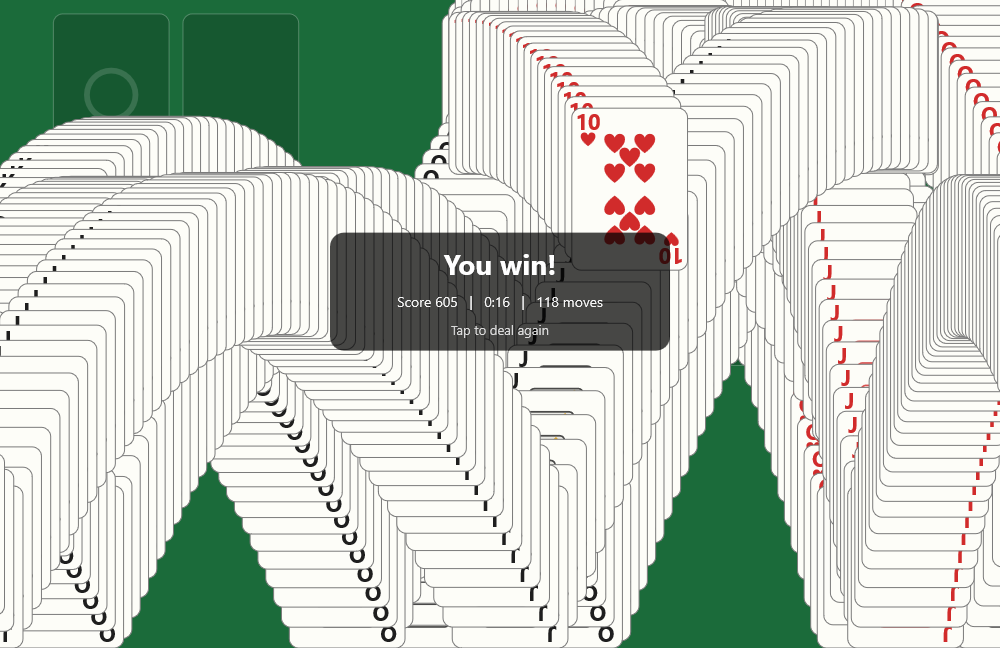 |

| Fireworks | Choosing a game | Phone: Klondike | Phone: TriPeaks |
| --- | --- | --- | --- |
| 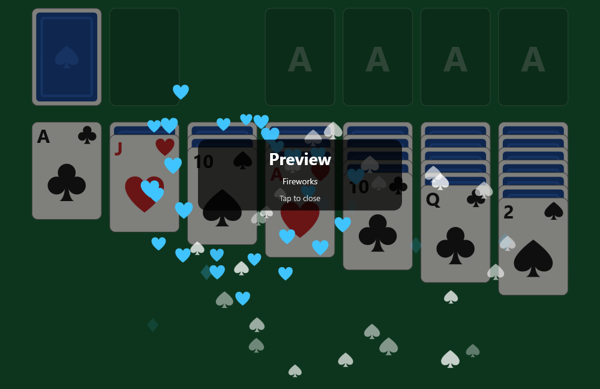 | 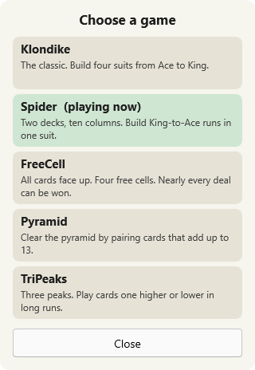 | 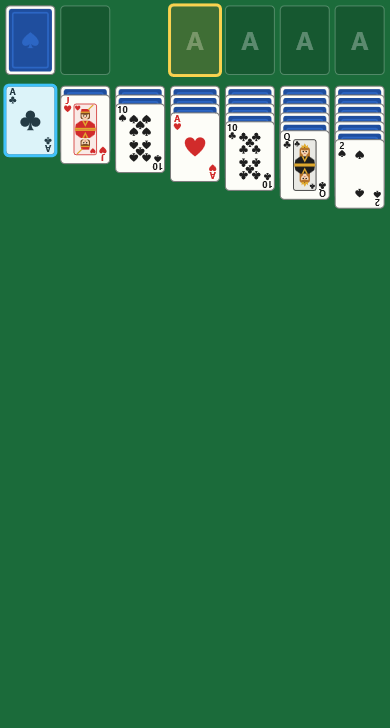 | 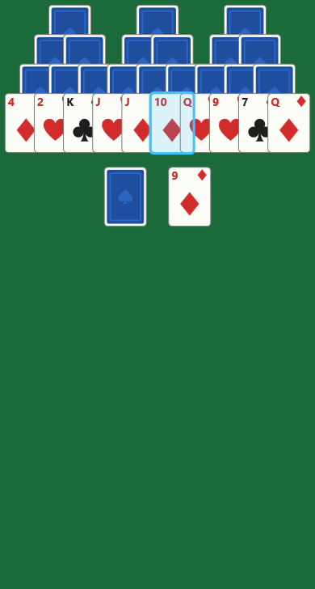 |

### Card styles

The Classic style is the default, with drawn pictures for the jack, queen and king:

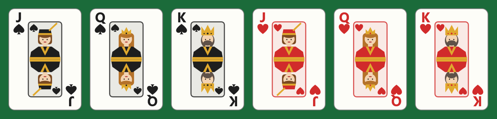

Menu → Options and statistics → Card style switches to the Modern style:


### Rotated phone (landscape)

Turning the phone switches every game to a wide layout.

| Klondike | Spider |
| --- | --- |
| 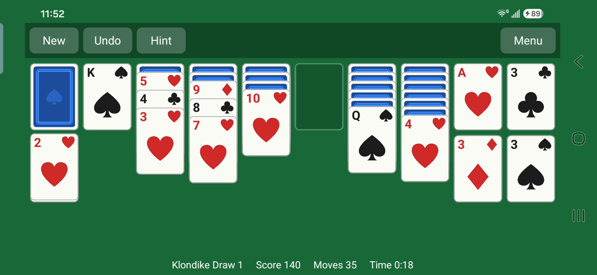 | 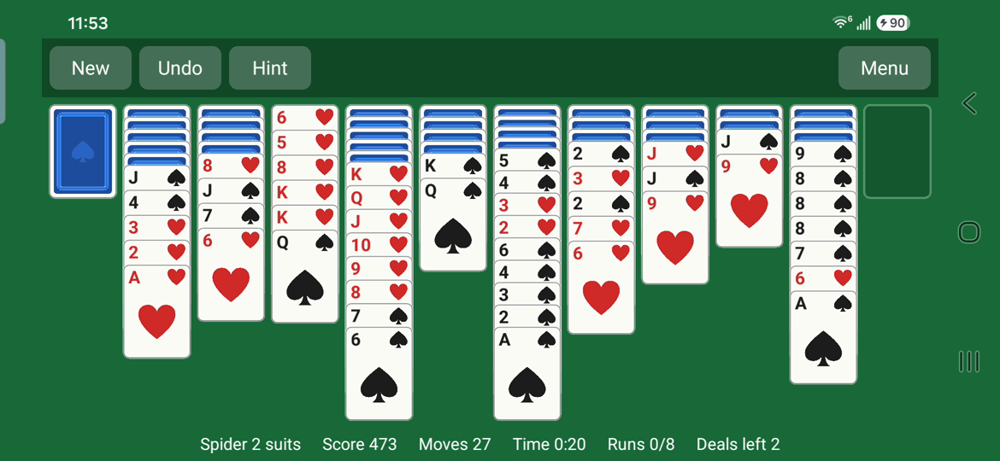 |

| FreeCell | Pyramid |
| --- | --- |
| 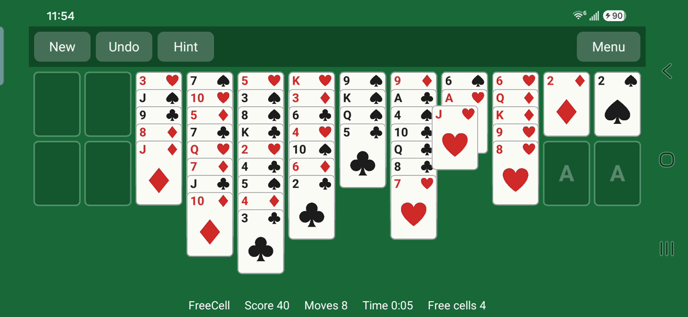 | 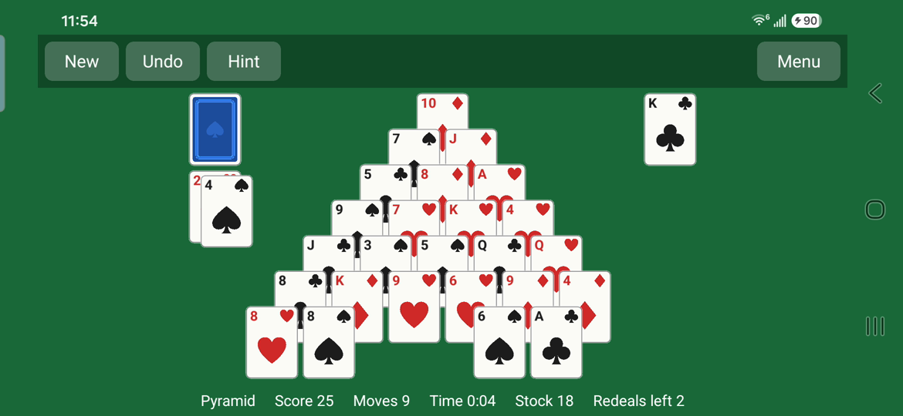 |

| TriPeaks |
| --- |
| 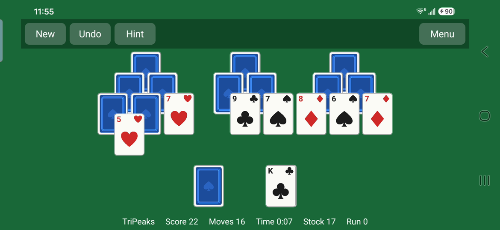 |

## Demo mode

The app can play every game by itself, at a pace you can follow, which is handy for recording videos:

- **Windows:** `Solitaire.exe -demo` (a 1280x720 window that closes after the last game)
- **Phones:** put an empty file named `demo.flag` in the app's data folder and start the app; it loops until closed. On a debug Android build: `adb shell run-as <package> touch files/demo.flag`

The demo keeps its own deals and statistics, so yours are untouched.

## Layout

| Path | What |
| --- | --- |
| `uCardGame.pas` | Pile-based engine every game derives from |
| `uGame*.pas`, `uGames.pas` | One unit per game, plus the registry |
| `uBoard.pas` | Board control: layout, card drawing, animation, win effects |
| `uMain.pas` | Form, toolbar, menus, help and options panels |
| `uStats.pas` | Statistics and settings |
| `uSound.pas` | Shuffle and win sounds, synthesised at run time (no audio files) |
| `uAutoPlay.pas`, `uSelfTest.pas`, `uDemo.pas` | Hint-following player, the in-app UI self-test and the demo mode |
| `tests\` | Console tests for the game engines |
| `tools\` | Deploy, artwork and deployproj scripts |
| `res\` | Icons and splash artwork |

## Building

Everything builds from the command line:

```bat
call "C:\Program Files (x86)\Embarcadero\Studio\37.0\bin\rsvars.bat"
msbuild Solitaire.dproj /t:Build /p:Config=Debug /p:Platform=Win64
```

- Console tests: `tests\run-tests.bat`
- UI self-test: `Win64\Debug\Solitaire.exe -selftest`
- Phones and simulator: `tools\deploy.ps1 android|iossim|iosdevice|all [-Launch]`

`Solitaire.deployproj` is generated by `tools\make-deployproj.ps1`; rerun it after adding files that must ship with the app. 
The iOS bundle id, signing identity, provisioning profile and test device are machine-specific and are kept out of source control: copy `Solitaire.local.props.example` to `Solitaire.local.props` and fill in your own. Without that file the app builds with the bundle id `com.example.solitaire`; Windows, Android and the iOS simulator need nothing more.

To stop those values being committed by accident, turn on the repository's hooks once per clone:

```bat
git config core.hooksPath tools/hooks
```

They refuse any commit or push containing a value from `Solitaire.local.props` or a term listed in `tools\private-terms.local.txt` (also ignored by git).
